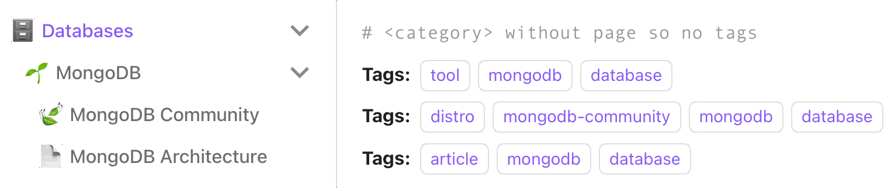

# Documentation



## Structure

```
<#category>/
├── <#category>/
│   ├── <#tool>/
│   │   ├── <#distro>/
│   │   │   └── <#article>
│   │   └── <#article>
│   └── <#article>
└── <#article>
```

### Category

* **Large-scale topic area**
* Can be nested, can contain tools, distros, and articles directly
* May have no page of its own — just a folder with `_category_.json` as a sidebar label.
* Do not have strict stucture

### Tool

* **Core technology within a category**
* Can contain distros and articles

````markdown
---
sidebar_label: 🔧 Tool Name
sidebar_position: 1
tags:
- tool
- tool-name
- category-name
---

# Tool Name

||Self-hosted|SaaS|
|-|-|-|
|**Name**|[Distro Name](https://link)|[SaaS Name](https://link)|
|**Type**|kubernetes-operator|terraform-provider|
|**Deploy**|helm-chart|crossplane|

## Architecture

- How it works
- Main terms

## Monitoring

- What metrics to pay attention to
- Alerts

## Platform integration

- How this tool is integrated into the platform
- How to use it
- How to debug

---

## Articles

* [Article title](./article-file.md)
````

### Distro

* **Specific distribution, operator, or managed implementation of a tool**
* Can have its own articles

````markdown
---
sidebar_label: 🔷 Distro Name
sidebar_position: 1
tags:
- distro
- distro-name
- tool-name
- category-name
---

# Distro Full Name

|**Distro**|[Distro Name](https://link)|
|-|-|
|**Type**|kubernetes-operator|
|**Deploy**|helm-chart|
|**Docs**|[link](https://docs-link)|
|**Backup**||
|**Scaling**||
|**CLI**||
|**UI**|web|

## Setup

* [Setup guide title](./setup-article.md)

## Usecases

### :white_check_mark: Basic: connect, create db/user, etc.

- Step or snippet

### Common: automate provision, etc.

- Step or snippet

## Monitoring

- Grafana dashboard reference
- Config snippets

## Maintenence

- Backup / Restore
- Scaling
- Upgrade

---

## Articles

* [Article title](./article-file.md)
````

### Article

* **Implementation guide or deep-dive scoped to a parent tool, distro, or category**
* Always positioned at the bottom of its parent
* Always use `sidebar_position: 90` or higher
* Do not have strict stucture

## File placement

```
devops-sandbox/website/docs/
├── .img/
└── db/
    ├── _category_.json                           (#category, no page)
    └── clickhouse/
        ├── .img/
        ├── clickhouse.md                         (#category with page, no _category_.json)
        ├── differrence-between-cloud-and-self-hosted.md  (#article)
        ├── clickhouse-cloud.md                   (#distro)
        └── altinity/
            ├── .img/
            ├── altinity.md                       (#distro)
            ├── altinity-setup-low-resource.md    (#article)
            └── altinity-automatic-backup.md      (#article)
```

Images go into a `.img/` subfolder next to the page that uses them:

```markdown

```

### Frontmatter

* Prefer frontmatter in the markdown file over `_category_.json` where possible
* Use `sidebar_label` to set the icon + display name, `sidebar_position` to control order

```yaml
---
sidebar_label: 🟨 ClickHouse
sidebar_position: 1
tags:
- tool
- clickhouse
- database
---
```

### Icons

* All sidebar labels must include an emoji
* Icons go in `sidebar_label` only — not in the H1 heading
* Use any appropriate emoji for categories, tools, and distros. Articles always use 📄

### Tags

First tag is the page type, second is the component name, the rest inherit from parent pages:

```yaml
tags:
- distro        # page type
- altinity      # component name
- clickhouse    # parent tool
- database      # parent category
```

## Search

* Search by `Ctrl+K` / `Cmd+K`
* Tag-based filtering is not supported by `docusaurus-search-local`

---

## Maintenance

### Local development

```bash
cd website
yarn start
```

### Deploy to GitHub Pages

```bash
yarn build
DEPLOYMENT_BRANCH=main GIT_USER=andrewozh yarn deploy
```

### Keep repo clean

Remove large unused files from git history to keep repo size under control:

```bash
brew install bfg
bfg --delete-files pritunl-cloud-architecture.png
git reflog expire --expire=now --all && git gc --prune=now --aggressive
```
